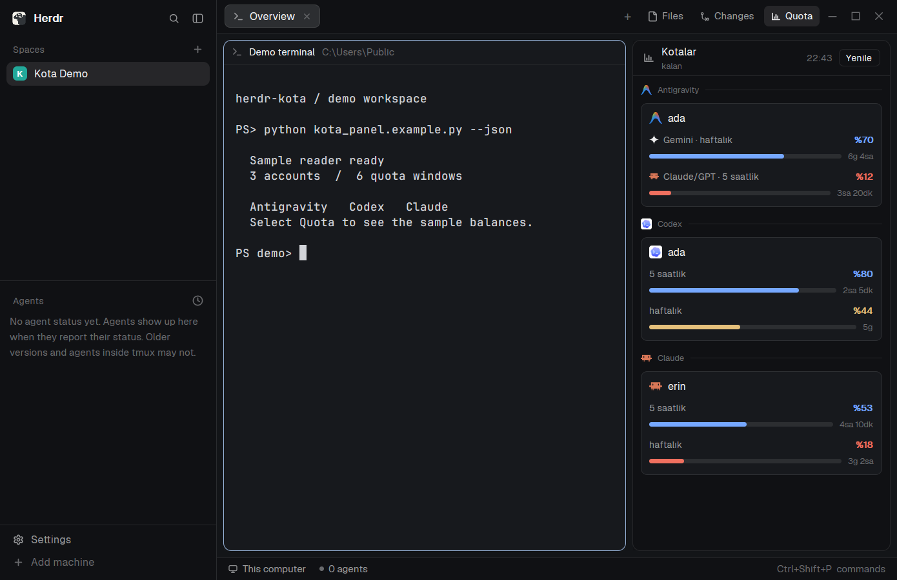

# Herdr Kota

See how much quota you have left while you work in Herdr. **Kota** adds a panel beside your terminal with account-by-account usage bars, remaining percentages, and reset times when your quota reader provides them.



## Read your quotas at a glance

| In the panel | What it tells you |
| --- | --- |
| **Quota** | Open or hide the panel from the tab bar next to Files and Changes. |
| **Account cards** | Tell Antigravity, Codex, Claude, and Grok accounts apart by name and provider icon. |
| **Usage rows** | Read the percentage **remaining** for each window, such as five-hour or weekly, with its reset time. |
| **Yenile** | Refresh now. The panel also checks every three minutes while the window is visible. |


*Both images show sample accounts. The panel labels are in Turkish.*

## Try it with sample data

You need **Herdr App** and **Python 3** on your PATH. The layout is based on Herdr App 0.1.18.

Give your Herdr agent this installation prompt.

```text
Read ~/.config/herdr-app/AGENTS.md, then add this layout:
https://github.com/Emrelushig/herdr-kota
```

To install it manually, follow these steps.

1. Copy [layouts/kota.json](layouts/kota.json) to `layouts/` in your Herdr app home, usually `~/.config/herdr-app`.
2. Copy [mods/kota/](mods/kota) and [mods/tabs-kota/](mods/tabs-kota) into that home's `mods/` directory.
3. Select **Kota** with **Ctrl+Shift+L**. Use **Quota** in the tab bar to show or hide the bundled sample accounts.

## Connect a real quota reader

To show live quotas, supply your own Python reader at `~/.herdr-hesaplar/kota_panel.py`. Herdr runs it locally with `--json`. Your reader fetches or reads the quota data and prints a JSON object to standard output.

Start from [the sample reader](mods/kota/kota_panel.example.py). Give each account a stable `profil` and use `agy`, `codex`, `claude`, or `grok` for `arac`. Set each row's `kalan` to the **percentage remaining**, from 0 to 100. Use an ISO timestamp for `reset` or a display label in `reset_metin`.

| JSON field | Example |
| --- | --- |
| `zaman` | `2026-11-26T19:30:00` |
| `hesaplar[].arac` | `codex` |
| `hesaplar[].ad` | `work` |
| `hesaplar[].satirlar[].ad` | `5 saatlik` |
| `hesaplar[].satirlar[].kalan` | `80` |
| `hesaplar[].satirlar[].reset_metin` | `2sa 5dk` |

Your reader handles provider authentication. The full data format and layout details are in [RECIPE.md](RECIPE.md).

## Türkçe

Kota, Herdr’da terminalin yanında ne kadar kullanım hakkın kaldığını gösterir. **Quota** ile paneli açıp kapatabilir, **Yenile** ile değerleri tekrar okutabilirsin. Her hesapta kullanım penceresi, kalan yüzde ve kaynak sağlıyorsa sıfırlanma süresi görünür.

Önce paketteki örnek hesaplarla deneyebilirsin. Gerçek kotalar için kendi Python okuyucunu `~/.herdr-hesaplar/kota_panel.py` konumuna koy. Çıktı biçimi için [örnek okuyucuya](mods/kota/kota_panel.example.py) bak.

## Credits

The layout and tab bar adapt [Herdr App 0.1.18](https://github.com/herdrdev/herdr-app/tree/v0.1.18). Herdr supplies the provider icons. See the upstream [Apache 2.0 license](LICENSE).
