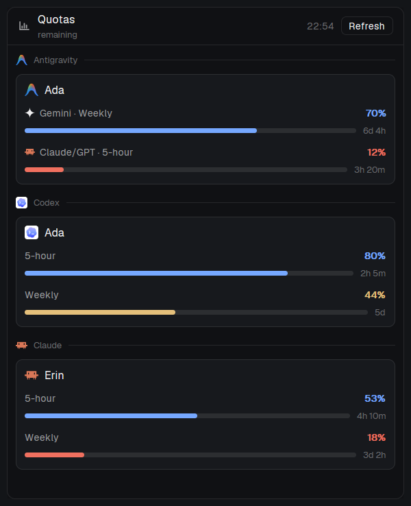

# Herdr Quota

See how much quota you have left without leaving Herdr. **Quota** adds a panel beside your terminal with a card for each account, bars for each usage window, and reset times when your reader provides them.


## Read your quotas at a glance

| In the panel | What it does |
| --- | --- |
| **Quota** | Shows or hides the panel from the tab bar next to Files and Changes. |
| **Account cards** | Identify Antigravity, Codex, Claude, and Grok accounts by name and provider icon. |
| **Usage rows** | Show the percentage **remaining** for each window, such as five-hour or weekly, and its reset time. |
| **Refresh** | Reads the latest values. The panel also checks every three minutes while the window is visible. |



*Both images show sample accounts.*

## Try it with sample data

You need **Herdr App** and **Python 3** on your PATH. The layout is based on Herdr App 0.1.18.

Give your Herdr agent this installation prompt.

```text
Read ~/.config/herdr-app/AGENTS.md, then add this layout:
https://github.com/Emrelushig/herdr-quota
```

To install manually, follow these steps.

1. Copy [layouts/quota.json](layouts/quota.json) to `layouts/` in your Herdr app home, usually `~/.config/herdr-app`.
2. Copy [mods/quota/](mods/quota) and [mods/tabs-quota/](mods/tabs-quota) into that home's `mods/` directory.
3. Select **Quota** with **Ctrl+Shift+L**. Use the **Quota** button in the tab bar to show or hide the panel.

## Connect a live quota reader

The bundled Python reader supplies sample data. For live quotas, write your own reader at `~/.herdr-quota/quota_panel.py`. Herdr runs it locally with `--json`. Your reader obtains the quota data and prints a JSON object to standard output.

Use [the sample reader](mods/quota/quota_panel.example.py) as a starting point. Give every account a stable `profile` unique within its provider. Existing readers from the earlier layout still work. The full format and fallback paths are in [RECIPE.md](RECIPE.md#built-from).

| JSON field | Example |
| --- | --- |
| `updated_at` | `2026-11-26T19:30:00` |
| `accounts[].provider` | `codex` |
| `accounts[].profile` | `work` |
| `accounts[].name` | `Ada` |
| `accounts[].windows[].name` | `5-hour` |
| `accounts[].windows[].remaining` | `80` |
| `accounts[].windows[].reset_text` | `2h 5m` |

`remaining` is a percentage from 0 to 100. Use an ISO timestamp in `reset` for a computed countdown or give the row a ready-to-display `reset_text`. Your reader handles provider authentication.

## Credits

The layout and tab bar adapt [Herdr App 0.1.18](https://github.com/herdrdev/herdr-app/tree/v0.1.18). Herdr supplies the provider icons. See the upstream [Apache 2.0 license](LICENSE).
