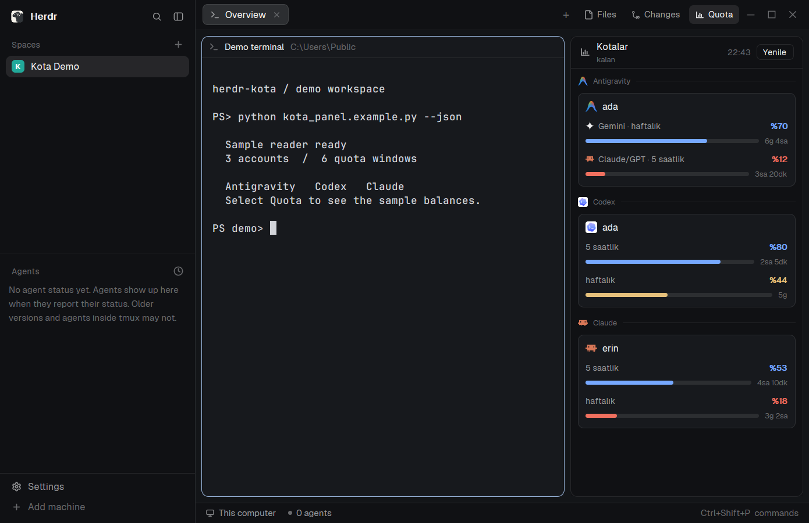

# Kota

See how much quota you have left without leaving your Herdr terminal. Open Quota for account cards with provider logos, remaining percentages, usage bars and reset times. Try it with the bundled sample data, then connect your own local reader for live Antigravity, Codex, Claude or Grok quotas.

## What you see

The window is the Herdr main layout. Root background is `canvas`. The left sidebar is 268px, chrome, not resizable by drag, min 44, max 480. Top to bottom: the workspace brand (46px), spaces and agents sharing the leftover height (each min 90), and the workspace footer (69px).

The work column has no drag divider. Its tab bar is 42px and drags the window. Under it, an 8px padded row with an 8px gap holds three things. The terminal fills the leftover width: pane cards with a 10px radius, 8px gap, a 1px `border`, a 1px `accent` focus ring, and a 30px pane header that stays visible. A single pane is framed too. Next, the Files and Changes stack is 368px, min 280, max 900, and starts hidden. Last, the kota panel is 320px, min 240, max 520, chrome background, 10px radius, 1px `border`. A 28px status bar sits under the row. The system title bar is hidden. macOS traffic lights sit at 12, 16.

The kota panel header is 44px with a small bar-chart icon, the words Kotalar and kalan, the time of the last read, and a Yenile button. Below, each provider is a dim title-case name, its logo, and a hairline. Each account card has an 8px radius, a 1px `border`, a `background` fill, and 10px horizontal and 8px vertical padding. The card title is the account name beside a 16px logo. A row shows the quota name, a colored percentage, a 6px bar, and the reset text. The active theme supplies the colors through `done` at 50% and above, `working` from 20% to under 50%, and `blocked` below 20%. Percentages above zero and below 10% show one decimal. At 99.5% or above the row says kullanılmadı unless the reader supplies `reset_metin`. A note row is dim text with no bar.

Provider logos are Herdr's own icons: Antigravity, Codex and Claude in color; Grok and Gemini tinted with the text color. A row whose name starts with Gemini or Claude also shows that logo at 12px.

## How it behaves

Yenile runs the quota script and replaces the list. The same read runs when the panel opens and every 3 minutes while the window is visible. While it runs, the time says yenileniyor… and the button says …. A failed read keeps the last list and shows the error in red. With no list yet, the error sits in a card, or the panel says okunuyor….

Quota in the tab bar hides the kota block when it is open and shows it when it is closed. The button uses the selected background while the panel is open. Files and Changes keep their own show and hide. The panel does not follow agent status. Nothing in it is clicked except Yenile. Narrower than 160px, the panel draws only the icon and the letter K.

## Built from

`layouts/kota.json` is main 0.1.18 with two changes: the tab block's mod is `tabs-kota`, and `work-body`'s last child is the block `kota` (`mods/kota`, 320px). Shipped mods in the layout: `workspace-chrome`, `spaces`, `agents`, `pane`, `files`, `changes`, `workspace-status`.

`mods/tabs-kota` is a clone of the shipped `tabs` mod at 0.1.18. After the Changes button it draws Quota when the layout has a node id `kota`. The click runs `layout.hide` or `layout.show` with `{ id: "kota" }`. Its window icons are `mods/tabs-kota/win-min.svg`, `win-max.svg`, `win-restore.svg` and `win-close.svg`.

`mods/kota/main.js` is the panel. It uses `theme`, `layout`, `window`, `home`, `appHome`, `readTextFile` and `exec`. Art is `mods/kota/quota.svg` and `icons/antigravity.svg`, `icons/codex.svg`, `icons/claude.svg`, `icons/grok.svg`, `icons/gemini.svg`.

The read looks for `~/.herdr-hesaplar/kota_panel.py`. When that file is missing or empty, it runs `mods/kota/kota_panel.example.py`. The command is `python <script> --json`, then `py -3 <script> --json`, then `python3 <script> --json`. Timeout is 180 seconds. It parses the first `{` in stdout. A cache at `~/.herdr-hesaplar/kota-calisma/son.json` paints the previous list before the first read finishes. The script's JSON is `{ zaman, hesaplar: [{ arac, baslik, profil, ad, hata, satirlar }] }`. A row is `{ ad, kalan, reset }` or `{ ad, kalan, reset_metin }` or `{ not }`. `kalan` is the percent remaining, 0 to 100.

## Watch out

The example script shows Ada and Erin. It does not read a real account. A person's own script replaces it at `~/.herdr-hesaplar/kota_panel.py` and must print the same JSON to stdout. Do not ship that script with real account names, home paths or tokens.

`tabs-kota` is a frozen copy of the tab bar. A later Herdr update does not flow into it. The Quota button only appears when a layout node is named `kota`.

Logos are Herdr's `icons/` files. They are not in this folder. Codex is a light tile and stays readable on a dark panel. Grok and Gemini are one-color glyphs.

The first `python` on PATH has to be a real interpreter. A Windows Store alias that fails to start is skipped for `py` and `python3`. A script that starts and exits non-zero is shown as the error. It is not tried again with another interpreter.

The panel does not create accounts, log in, or call `agy`, `codex`, `grok` or `claude` itself.

## Done when

`herdr-app check` passes for `mods/kota` and `mods/tabs-kota`. Switching to the layout shows the terminal, Files and Changes, and a Quota button beside Changes. Quota hides and shows the right-hand panel. With no personal script, the panel lists Ada under Antigravity and Codex and Erin under Claude, with logos, bars and percents. Yenile runs the script again. A script that prints no JSON shows the error in the panel and leaves the window usable.
